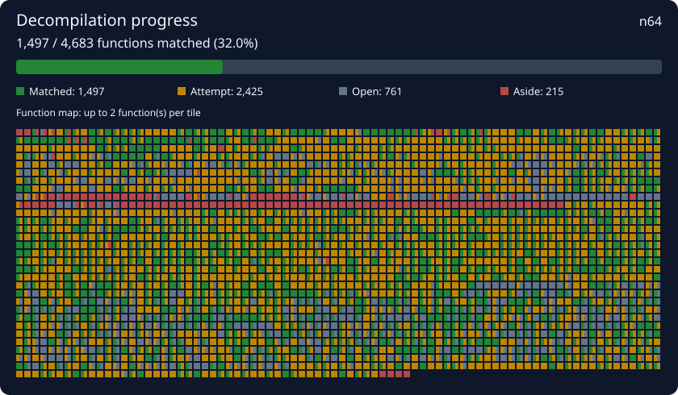

<!-- decompdecomp:progress:start -->
- **Progress:** 1497 matching function(s), 2434 best attempt(s)
- **Completion:** 1,497 / 4,683 functions (32.0%). 215 set aside, excluded from completion.
<!-- decompdecomp:progress:end -->

<!-- decompdecomp:visuals:start -->
## Progress map

Green: matched. Gold: attempted. Grey: open. Red: set aside. Functions follow address, then source unit and name order.
The image and tagged counts update on save. Keep project notes outside the hidden `decompdecomp` comment pairs to preserve them.
<!-- decompdecomp:visuals:end -->
